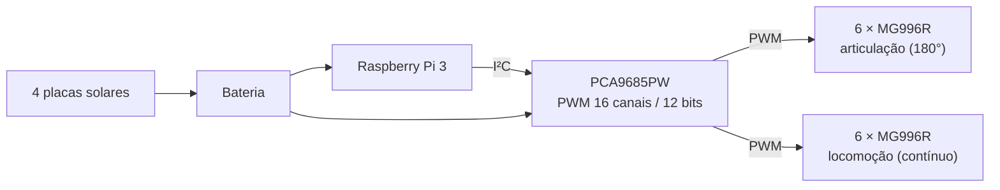

# Eletrônica

Componentes e integração elétrica do Robô Bio V2.

## Componentes

| Componente | Interface | Função |
| ---------- | --------- | ------ |
| Raspberry Pi 3 | — | Computador de bordo: lógica de alto nível, comunicação e futuros módulos de visão |
| Estardyn PCA9685PW | I²C | Driver PWM de 16 canais e 12 bits — comanda os 12 servos de forma independente |
| Servo MG996R (×6) | PWM | Articuladores do rover (180°) |
| Servo MG996R adaptado (×6) | PWM | Locomoção (rotação contínua) |
| Placa solar (×4) | — | Recarga da bateria |

## Acionamento dos servos

A Raspberry Pi 3 se comunica com o **PCA9685PW** via I²C; o driver gera os sinais PWM de cada canal. Dos 16 canais disponíveis, 12 são usados pelos servos:

Nos servos de locomoção, o potenciômetro foi removido e o chanfro da engrenagem lixado (ver [Mecânica](../mecanica/index.md#conversao-dos-servos-para-rotacao-continua)). Com isso, o sinal PWM passa a controlar **velocidade e sentido** de rotação, e não mais a posição.

## Energia solar

Como apoio ao projeto de extensão em escolas, foram integradas **quatro placas solares** ao robô, voltadas à recarga da bateria.

!!! warning "Documentação pendente"
    A documentação elétrica desse subsistema — dimensionamento, proteção e gestão de carga — será detalhada em uma atualização futura.

## Registros

| Item | Status | Observação |
| ---- | ------ | ---------- |
| Raspberry Pi 3 | Integrada | Montada no chassi |
| PCA9685PW | Integrado | 12 de 16 canais em uso |
| Placas solares | Integradas | 4 unidades |
| Esquemático elétrico completo | Em definição | — |
| Dimensionamento e proteção da bateria | Em definição | — |

!!! danger "Segurança elétrica"
    Antes de ensaios, documente tensões, correntes máximas e o procedimento de energização.
