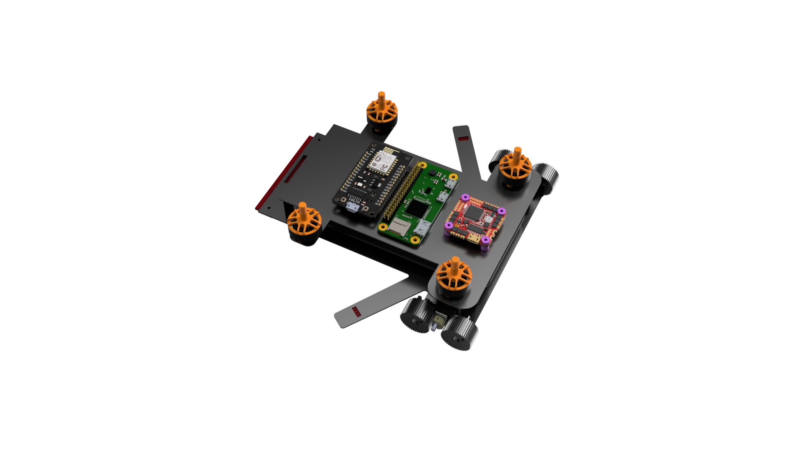
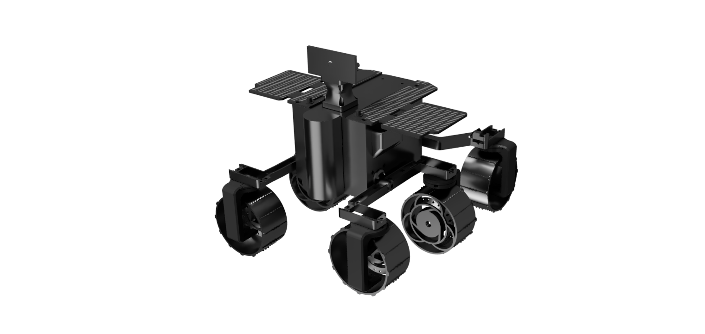
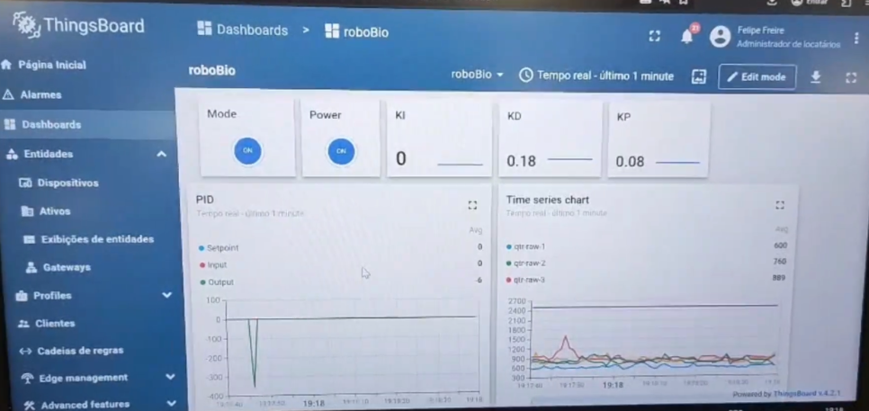
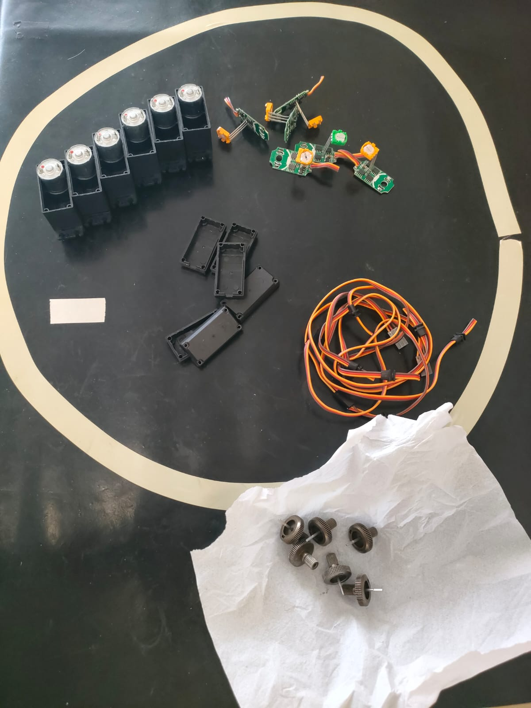

# Galeria

Fotos da montagem, dos ajustes nos motores e da evolução mecânica do Robô Bio — do protótipo inicial à estrutura preparada para os testes de controle e software.

## Versões

<figure markdown>

<figcaption>Robô Bio V1</figcaption>
</figure>

<figure markdown>

<figcaption>Render 3D da V2</figcaption>
</figure>

<figure markdown>

<figcaption>V2 montado, com placas solares</figcaption>
</figure>

<figure markdown>

<figcaption>Telemetria da V1 no ThingsBoard</figcaption>
</figure>

## Montagem e motores

<figure markdown>

<figcaption>Início da montagem — estrutura, servos e Raspberry Pi</figcaption>
</figure>

<figure markdown>

<figcaption>Engrenagem acoplada ao motor</figcaption>
</figure>

<figure markdown>

<figcaption>Engrenagem com chanfro, antes do ajuste</figcaption>
</figure>

<figure markdown>

<figcaption>Engrenagem após a remoção do chanfro</figcaption>
</figure>

<figure markdown>

<figcaption>Remontagem do conjunto motor-engrenagem</figcaption>
</figure>

<figure markdown>

<figcaption>Detalhe da remontagem dos motores</figcaption>
</figure>

