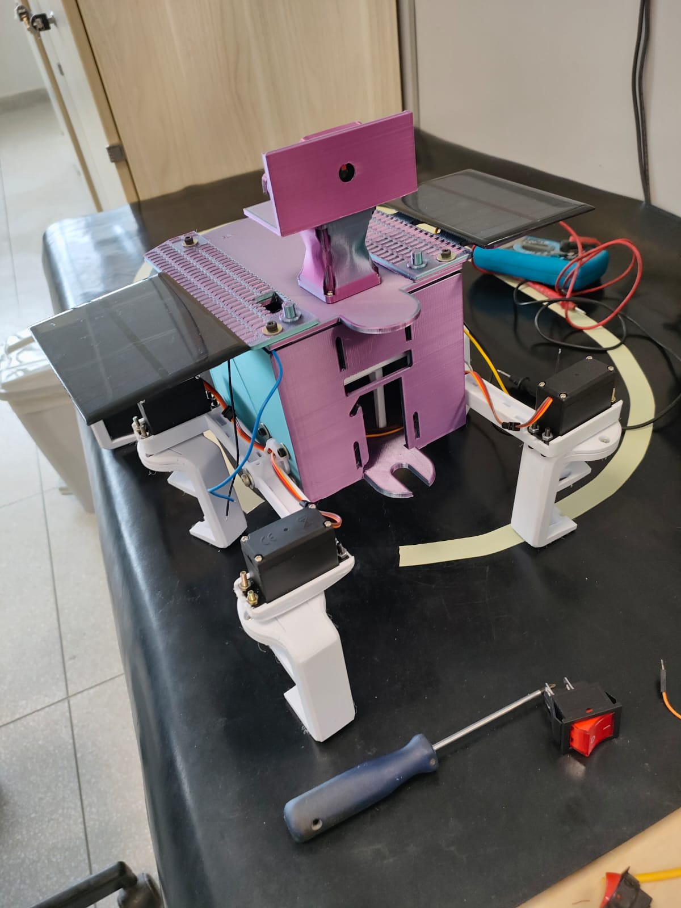

# Robô Bio — Seguidor de Linha

  <strong>Time:</strong> Robotics Titans UnB
  <strong>Origem:</strong> FSE — FCTE/UnB
  <strong>Versão atual:</strong> V2 (em desenvolvimento)

{ .figura-destaque }

O **Robô Bio** é um seguidor de linha autônomo desenvolvido inicialmente como trabalho final da disciplina **Fundamentos de Sistemas Embarcados (FSE)**, da Faculdade de Ciências e Tecnologias em Engenharia (**FCTE/UnB**).

O projeto partiu da **V1** PID clássico, sensores de refletância e telemetria via ThingsBoard, passou por um novo chassi na **V2** e segue em direção a um robô mais robusto: calibração de PID por **algoritmos bioinspirados** e delimitação do trajeto por **visão computacional**.

## Linha do tempo

| Etapa | Destaques | Status |
| ----- | --------- | ------ |
| [Robô Bio V1](projeto/v1.md) | ESP32 + ESP-IDF, sensores de refletância, PID manual, telemetria MQTT/ThingsBoard | Concluída |
| [Robô Bio V2](projeto/v2.md) | Novo chassi impresso em 3D, Raspberry Pi 3, PCA9685PW, 12 servos MG996R, placas solares | Em desenvolvimento |
| Próximos passos | PID por algoritmos bioinspirados, visão computacional do trajeto | Planejado |

## Áreas de desenvolvimento

  <a class="area-card" href="mecanica/">
    Área 01
    Mecânica
    Chassi da V2, impressão 3D em PLA/PETG e conversão dos servos para rotação contínua.
  </a>
  <a class="area-card" href="eletronica/">
    Área 02
    Eletrônica
    Raspberry Pi 3, driver PWM PCA9685PW, 12 servos MG996R e placas solares.
  </a>
  <a class="area-card" href="software/">
    Área 03
    Software e controle
    Loop em tempo real, controle PID, telemetria e visão computacional.
  </a>
  <a class="area-card" href="galeria/">
    Registro
    Galeria
    Fotos da montagem, dos ajustes nos motores e da evolução mecânica.
  </a>

## Equipe

| Integrante | Papel |
| ---------- | ----- |
| [Felipe das Neves](https://github.com/FelipeFreire-gf) | Desenvolvimento do projeto (mecânica, eletrônica e software) |

!!! tip "Contribuição"
    Mantenha títulos objetivos, registre decisões com contexto e evite duplicar conteúdo entre áreas. Quando um tópico for interdisciplinar, referencie a área dona do conteúdo.
