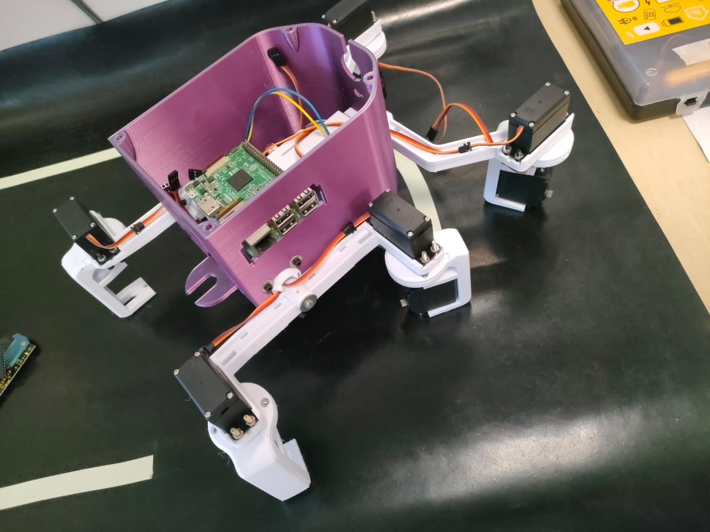
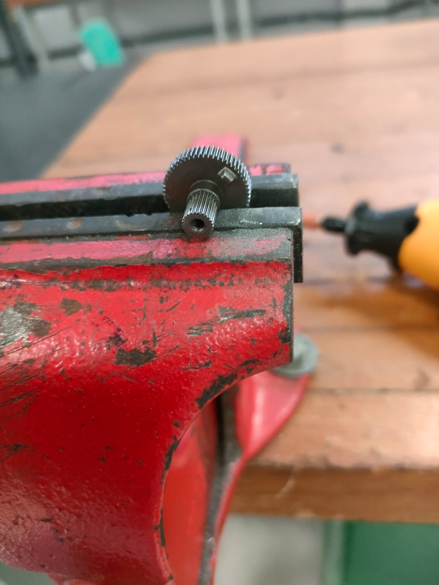
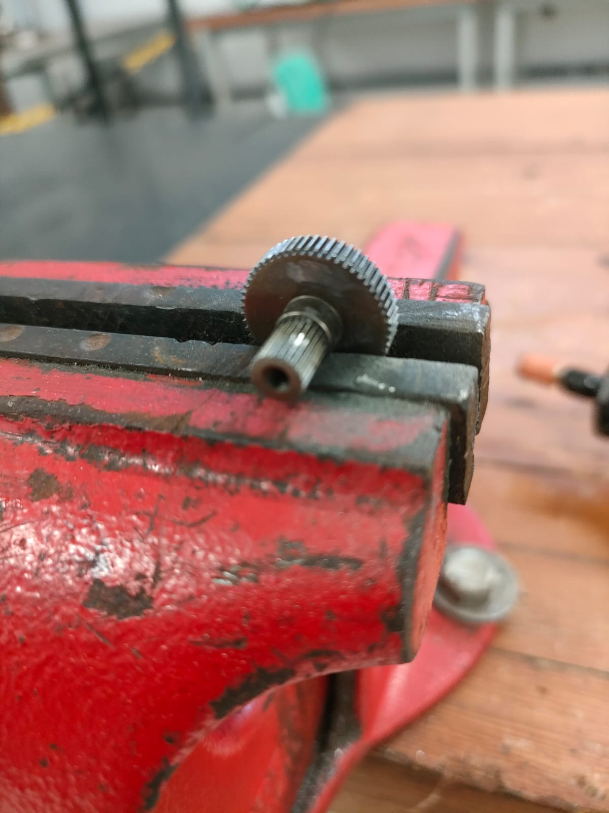
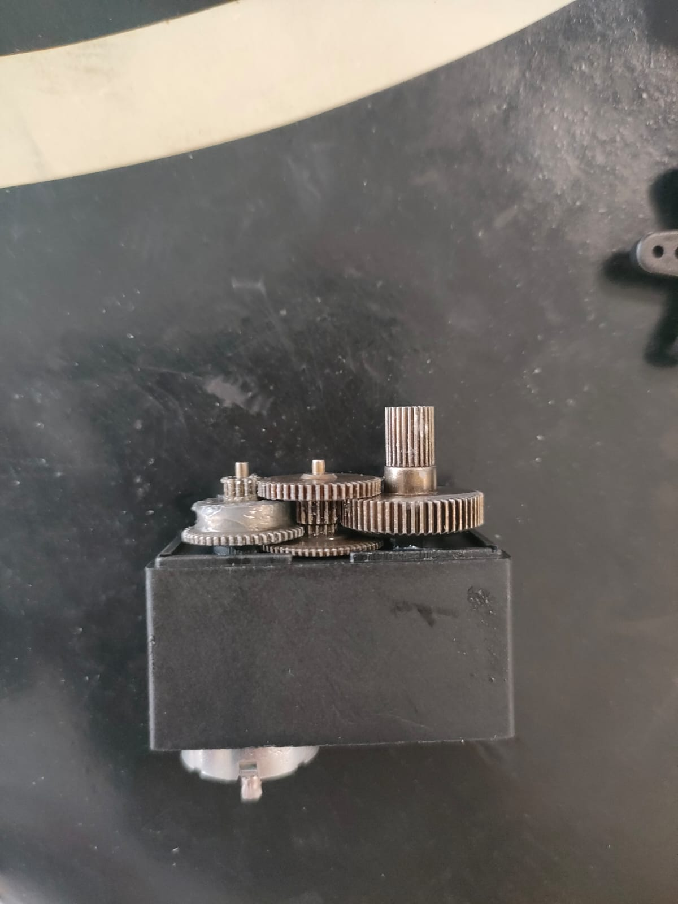
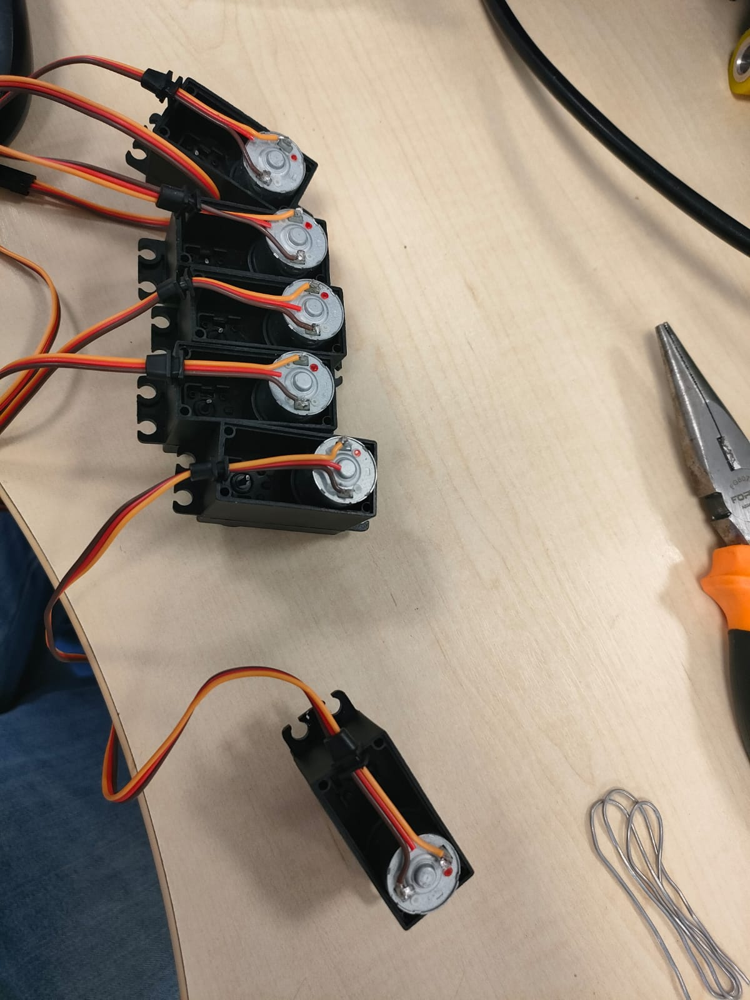

# Mecânica

Na V2, a mecânica deixa de ser o gargalo que travou a V1 na manta emborrachada.

## Chassi

O chassi é um rover de **seis rodas com suspensão articulada**, com peças impressas em **PLA** e **PETG** e adaptações para acomodar:

- a Raspberry Pi 3
- a fiação de prototipagem
- as placas solares
- o volume necessário para testar novas ideias sem refazer a estrutura a cada iteração

## Atuadores

O robô utiliza **12 servos MG996R**, divididos em duas funções:

| Quantidade | Modo | Função |
| ---------- | ---- | ------ |
| 6 | Rotação contínua (adaptado) | Locomoção — acionamento das rodas |
| 6 | Padrão 180° | Articuladores do modelo |

## Conversão dos servos para rotação contínua

A locomoção reutiliza a experiência da primeira versão: os servos das rodas foram adaptados para girar continuamente, permitindo acoplar as rodas do rover com mais folga e repetibilidade.

1. Abrir o servo MG996R e retirar a engrenagem de saída
2. **Remover o potenciômetro** de realimentação
3. **Lixar o chanfro** (batente) da engrenagem, que limita o curso a 180°
4. Remontar o conjunto motor-engrenagem

<figure markdown>

<figcaption>Engrenagem com o chanfro, antes do ajuste</figcaption>
</figure>

<figure markdown>

<figcaption>Engrenagem após a remoção do chanfro</figcaption>
</figure>

<figure markdown>

<figcaption>Engrenagem acoplada ao motor</figcaption>
</figure>

<figure markdown>

<figcaption>Remontagem do conjunto motor-engrenagem</figcaption>
</figure>

## Registros

| Artefato | Status | Observação |
| -------- | ------ | ---------- |
| Chassi V2 | Montado | Impresso em PLA e PETG |
| Servos de locomoção | Adaptados | 6 × MG996R em rotação contínua |
| Servos de articulação | Montados | 6 × MG996R a 180° |
| Suporte das placas solares | Montado | 4 placas |

!!! note "Controle de versão de CAD"
    Registre a revisão do modelo (ex.: `R01`, `R02`) a cada mudança dimensional relevante.
