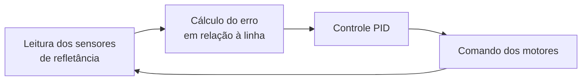

# Software e controle

O software do Robô Bio segue a abordagem de sistemas embarcados da FSE: requisitos, arquitetura modular, leitura de sensores, cálculo do erro em relação à linha e controle PID para correção da trajetória.

## Loop de controle

O firmware mantém um loop em tempo real:

## Controle PID

O controlador corrige a trajetória a partir do erro `e(t)` entre a posição desejada (centro da linha) e a posição medida:

$$u(t) = K_p \, e(t) + K_i \int e(t)\,dt + K_d \, \frac{de(t)}{dt}$$

| Termo | Efeito |
| ----- | ------ |
| Proporcional (`Kp`) | Correção imediata, proporcional ao erro atual |
| Integral (`Ki`) | Correção do erro acumulado ao longo do tempo |
| Derivativo (`Kd`) | Correção proporcional à taxa de variação do erro |

A saída `u` é aplicada como diferença de velocidade entre os motores, fazendo o robô voltar para a linha.

## Ajuste dos ganhos

| Versão | Método | Status |
| ------ | ------ | ------ |
| V1 | Manual, com apoio da telemetria no ThingsBoard | Concluído |
| V2 | Algoritmos bioinspirados para obter `Kp`, `Ki` e `Kd` | Planejado |

## Telemetria

Na V1, o ESP32 publicava os dados via **MQTT** para o **ThingsBoard**, permitindo acompanhar o robô em tempo real e calibrar o PID à distância. Detalhes em [Robô Bio V1](../projeto/v1.md#telemetria).

## Visão computacional

Em paralelo, modela-se um sistema de **visão computacional** que delimita o caminho à frente do robô, complementando os sensores de refletância e tornando o seguimento de trajeto mais robusto nas próximas iterações. Na V2, esse processamento fica a cargo da Raspberry Pi 3.

## Registros

| Módulo | Status | Observação |
| ------ | ------ | ---------- |
| Firmware V1 (ESP-IDF) | Concluído | Sensores → PID → motores |
| Telemetria MQTT/ThingsBoard | Concluído | V1 |
| Software V2 (Raspberry Pi 3) | Em desenvolvimento | Comando dos servos via PCA9685 |
| PID por algoritmos bioinspirados | Planejado | — |
| Visão computacional do trajeto | Em modelagem | — |
